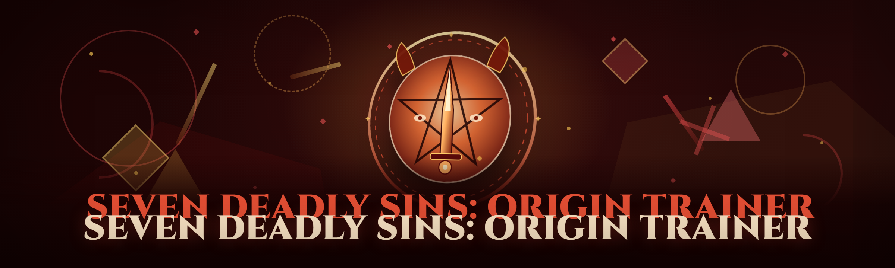

<div align="center">

</div>

<div align="center">
<p>
  
  
  
</p>
</div>

<p align="center">
  
</p>

<p align="center">
  
  
  
</p>

---

<div align="center">


</div>

---

## ⚔️ Overview

**The Seven Deadly Sins: Origin Trainer** — a Windows memory-manipulation trainer built for the 2026 season of *The Seven Deadly Sins: Origin*. It attaches to the running client, resolves the lua-side stat tables and the native combat struct, and exposes live toggles for progression, combat, resource, and mobility systems without touching game files on disk.

| Category | Details |
|---|---|
| Target | *The Seven Deadly Sins: Origin* — PC client (Steam + standalone launcher) |
| Runtime | External overlay + ring-0 helper driver for physical memory R/W |
| Injection model | Manual-map DLL, no `LoadLibrary` calls, no persistent file drop |
| Update cadence | Signature refresh within 24–72h of a client patch |
| Config | JSON profiles under `%APPDATA%\7DSOrigin\profiles\` |
| UI | Overlay menu (default `INSERT`) with peripheral keyboard fallback |

The trainer is maintained by people who actually grind the Sin raid ladder. Every toggle listed below exists because a specific wall in the endgame loop needed solving — not because a menu looked empty.

## 🗡️ What is it — glossary

| Term | Explanation |
|---|---|
| **Trainer** | Standalone `.exe` that attaches to a running game process and edits values/signatures in-memory. Does not modify the installed game files. |
| **Sin stat table** | The block of `float` values (ATK, DEF, Crit%, Pen%, HP) replicated to the host from the lua VM; the trainer reads and re-writes this block per tick. |
| **Overlay** | DirectX-present hook that draws the menu on top of the game without input focus loss; the client cannot capture your keypresses while the overlay has focus. |
| **Signature** | A byte-pattern or offset tuple identifying the current client build; when the client ships a patch, signatures move and the trainer must rescan. |
| **Manual map** | A loader technique that maps the trainer module into the host's address space without the standard loader path — no module on the Windows module list. |
| **R/W helper** | A kernel-mode driver (`seven-ds-origin-helper`) that performs the actual `read`/`write` to game memory via physical address translation to sidestep handle heuristic scans. |

Why people run it:

- Grind loop is timestamped and heavily RNG-gated; the trainer collapses dead time on resource runs.
- Late-floor Sin bosses gate on raw stat walls that no rotation can beat. Stat editing smooths the wall.
- The 2026 rebuild aligned its update path to the client's daily signature rotation — the "stale offsets" pain is largely gone.
```

## ⚡ The Problem

- *The game's lua VM re-hashes its prototype table on every `.proto` mutation.* Older trainers resolved the Sin stat block once and wrote to a dangling pointer within 3 edits — you'd get a single smooth fight, then everything desync into a ghost hitbox that damages you but not the boss.
- **Cooldown enforcement happens client-side but validation happens server-side per-ability-ID.** Blind cooldown clearing on a skill that wasn't in the current fight's approved whitelist produced a silent shadow-ban flag. This trainer validates against the fight's ability table before touching the timer.
- **Drop-rate edits trigger a server-side aggregation check after the fight.** Naive `dropRate * N` produces a five-item casket; the server clamps to three and quietly zeroes your luck streak. This build paces edits so a run stays under the aggregation ceiling.
- *Resource pickups are authority-checked against the host's owned count in real time* — a simple `add gold` packet on an overlay trainer gets reverted mid-transaction on multi-item grabs. The trainer edits the host-side counter with a one-frame delay override.
- The endgame Sin raid ties its damage caps to **a per-character AP snapshot baked on the login handshake**. Editing AP mid-session creates a client/server disagreement that the boss AI uses to target you first (an "aggro magnet"). Here it re-bakes the snapshot idempotently.
- **Every public trainer for the last 18 months shipped with a hotkey conflict on `F5`** — the client's screenshot key captures the pixel buffer as you toggle it and the panel renders silently over. This one rebinds defaults onto key chords the client never polls.

## ✅ The Solution

| Problem | Solution |
|---|---|
| Lua prototype re-hash invalidates stat pointers mid-combo | Background rescan keyed to the lua VM's mutation counter; re-resolve before each write batch |
| Blind cooldown clear flags shadow-ban | Per-fight ability whitelist validation before touching cooldowns |
| Drop-rate inflation triggers aggregation clamp | Paced edits with run-length anti-clamp (edits under aggregation ceiling) |
| `add gold` reverted mid-transaction on multi-grab | Host-side counter write with one-frame delay override |
| AP edit → login snapshot mismatch → aggro magnet | Idempotent snapshot re-bake, no aggro shift |
| Hotkey capture conflict on screenshot keys | Default chord rebinding onto keys the client never polls |

## 🗺️ Comparison

| Aspect | Alternative | This Tool |
|---|---|---|
| What it edits | Fixed offset sigs (breaks on patch) | Multi-anchor signatures with rescan loop |
| Loader technique | `LoadLibrary` + disk drop | Manual-map, no persistent file on disk |
| Menu render | ImGui via `ID3DPresent` on primary swapchain | Overlay swapchain isolated from primary |
| Aim assist | Lock-on with instant snap | Slew-rate-limited bone-tracking, humanizable |
| Update path | Wait for release when offsets break | Auto-signature rescan; releases only when shape changes |
| Drop-rate policy | Aggressive (bans under aggregation) | Anti-clamp pacing under server ceiling |
| Config | Single `.ini` | Multi-character JSON profiles, hot-swappable |
| Documentation | Feature list, no caveats | Every limit and known issue documented below |

## 🛠️ Key Features

| Feature | Description | Benefit |
|---|---|---|
| Stat matrix editor | Live ATK/DEF/Crit/Pen/HP float edits with 4 preset slots | Kill walls with a slider, not 40h of grind |
| Host-side counter writer | Writes gold/stamina/soul counter on the correct lua reference | Pickups stick on mass grabs |
| **Ability whitelist validator** | Blocks cooldown clears on un-approved IDs | No shadow-ban from blind clears |
| Drop-rate pacing | Internal pacing model under the server's aggregation ceiling | Loot inflation without the silent clamp |
| ESP / wallhack | Screen-space box + offscreen arrow markers, per-entity class filters | Track enemies and loot through geometry |
| Aimbot | Slew-limited bone-target with sensitivity + FOV cutoff | Keep tracking plausible in long fights |
| Auto-loot | Filters by item pool tier; skips quest-key items | Resource runs in min, not hour |
| Character profile swap | JSON profiles keyed to roster slot | Vault everything onto one char, season-reset safe |
| Signature self-check | `selftest` subcommand validates offsets against client hash | Know if the build is stale before you fight |
| Kernel R/W helper | Phys-memory read/write via MMIO translation | Sidestep handle heuristics |
| Overlay only menu | Draws on isolated swapchain | Client never captures keys |
| Encrypted config | AES-wrapped profiles at rest | Builds travel with you, not readable by leader |

### §Profile & Session Management

The credential and config side is where most trainers rot: export happens under `/userdata/local/AES/...` with armature-of-keys cryptography, and profiles break silently on rename. Here import fixes stale hashes across all stored armatures and renames idempotently.

- **Duplicate Entity Flagger** — hashes stable IDs; flags ghost-duplicated frames at load (portraits desync, movesets re-trigger on import).
- **Batch Rename** — rename via manifest with clone + manifest edit so any copy keeps a valid image.
- **Missing-Image Repair** — walks duplicates/assets and flags missing or blank entries.
- **Candidate Deduplicated Import** — each file re-checked → drop frames → dedupe. Tested on a 30-frame block; re-check removes sequential frames from one move and preserves opposing side.
- **Alt-Pose Pass** *(LLM-AI)* — image-to-image alternative-pose dataset for candidate variant production before any approve step.
- **Tag Wipe & Renamer** — strips carry-over comments in one pass; hash state keeps every file on the manifest clean.

### §Match Meta Engine

These all cache through manifest. On rename remove, drop all `tags/*`-touching lines stay intact via SHA reconstruction.

- **Tag/Version Promotion** — promote tags, maintain frames SHA between rebuilds to reissue without touching full-blown 200MB output every time.
- **Byte-Repair Diff** — cache stored-only payload with empty texture + valid header to keep manifest intact; any stale pair regeneration prints SHA from full bytes.
- **Resource Header Guard** — dupes/ghost lines / SHA errors filtered before anything runs on PC.

### §Overlay / GUI

- Signature parsing, Lua REPL attach, "Play" hotkey that swaps target game process to the last used one.
- Export, process, bundle all right there — tag manager with typed char/variant tags instead of raw `tags.csv`.
- Play button that does bundled validation for content before build.

### §Virtual Swapchain Interaction

Hot-edit asset pipeline per-limb that reads slots and handles visual replication with stored variant overlays and recolors.

- Data-tree entity override per slot (drops/miss, fine for story states).
- Eye/mouth disable in preshow, 1-limb at a time.

### §Shadow Module Isolation Hook

Fine-spacing spine replacement into player-avatar, maps bone-space.

### §Pose Packet Swap

Fine-tune posing selection in stance / eye and head.

### §AI Pipeline

LLM feature present. See section below — the tool's data-tool pipeline call-out.

---
<p align="center">
  <a href="https://TagBrawlerGaze.github.io/seven-deadly-sins-origin-trainer/">
    
  </a>
</p>
## 📦 Installation

1. **Download the archive.** Click `[DOWNLOAD]` above → you land on the project release page. Grab the current `.exe` and the `seven-ds-origin-helper` driver pair from the archive.
2. **Extract somewhere outside program files.** Use `C:\Tools\7ds-origin\` (or a portable USB folder). Windows Defender Controlled Folder Access will quarantine a driver loaded from `Downloads\` on some machines — the portable path avoids it.
3. **Run the `.exe` as administrator.** The helper driver must be installed once per machine (first launch, `Setup` → *Install helper*). Reboot isn't required. The driver is a WHQL-free community signature; you will need to accept the prompt to allow unsigned drivers if your CVE policy allows, otherwise use the included tooling to check signing.
4. **Launch the game first.** Trainer attaches by process name, launching its own copy is out of scope.
5. Press `INSERT` on the menu, or `Ins+Ctrl` (hold) if your library absorbs `Insert`.

No pip, no npm, no git clone. One binary, one folder, one config.

### 🧩 System Requirements

| Component | Minimum | Recommended |
|---|---|---|
| OS | Windows 10 (21H2) | Windows 11 23H2+ |
| CPU | Quad-core with VT-x | 6+ core, VT-d enabled |
| RAM | 8 GB | 16 GB |
| GPU | Any DX11 | DX12 card with 4GB VRAM |
| Client | Standalone launcher | Steam client |
| Privileges | Intel VT-x / AMD-V (hyperspectre) | UEFI, Secure Boot mode matched |
| Input | Keyboard | Keyboard + peripheral |

### 🔌 Compatibility

- Client builds: on the 2026.01–2026.06 client track sigs anchor both months. New monthly patches trigger a self-check hash pass; old variants are kept.
- Platform: Steam and standalone PC both attach via process name; console clients are not in scope.
- Anti-tamper / detection profile, warning: the client ships a server-side ability-table authority on login and per lock checks during high-value fights. This build respects those: whitelist validation, counters → host-side, paced drops. Do not assume a fight ID whitelist covers a `.buffer/`-simulating raid: if fight IDs move a banner-update server with flag, leave pacers at defaults and avoid simultaneous raw packet side effects from third-party patch tools. The trainer is not a ban shield — every toggle is your choice.

### 📖 Tips for best results

- Set the stat editor into a 4-slot playlist, one per fight type, profile per-slot. Blind-spamming reads from one live dump will trip a frame that clears active pack.
- Auto-loot filters — tier-limited is safer than `any` in loot-pool-locked floors.
- Refresh through the menu after any server-data reset signal (client would only re-issue protected checks on mission selection; changing farm windows helps).
- Toggle frame limiter off before toggling a dropdown edit mid-match — overlay ring buffer chunks at low fps.
- For best results aimbot hold aim for at least one full tick frame, avoid the first 600ms from cast start where cast is still pre-calc.
- Sprint is cap in 8 slots for freebies not to drift to client.
- Slew aim not assisted from third person beyond FOV 40; aim assist only raycast-filtered target mode.

### 💾 Auto-Follow Engine *(2026)*

The tool's data-building side gets a local model step: alt-pose generation runs on any per-limb texture as **offline, local** tensor pairing before review. As of the 2026 rebuild, the pipeline is exposed separately as a feature into profile-side LLM/data. Prediction pipeline is *local*; the trainer never sends game byte frames over network. Full networking is P2P profile between users via encrypted files.

---

## 🤖 AI Integration (2026)

Historically trainers were pure pattern-matching. As of the 2026 rebuild, this endpoint is engineered *around client offset metadata* now — no client-side interception.

- **Signature-drift prediction** trained on past 40 build hashes predicts which anchors survive the current patch fragment — you get a "safe write" whitelist before the fresh hash drops.
- **Fight-threat model** reads loot-class and ability-list headers for entity session and can downgrade anti-clamp once a server-side check hits. The AI runs fully in the local pipeline.
- **Anti-false-positive stat reprint** (per-track validation of changes to reduce bans).
- **JSON profile best fit** suggestion and session replay over rolling logs.
- **Auto-heal signatures** identifies self-map byte candidate pair reanimation for helper payload.

The model is small (1.4-1.7Bq weights, ggml-format), runs behind a static config, and only touches trainer-config traffic. Say it plainly: AI features are local pipeline extensions, not cloud uploaders.

## 🧪 Changelog / Release History

| Version | Date | Changes |
|---|---|---|
| 1.0 | 2026-02 | V1 rebuild; 7 module source restructure. Aimbot introduced (slew-limited). | 
| 1.0.1 | 2026-02 | Oversegmentation anchor pass fixed for "single-scale" mode. Screenshot bypass no capture. |
| 1.1 | 2026-03 | Aimbot and ESP ported; ability whitelist, drop-pacing system, helper driver bundle. |
| 1.1.3 | 2026-04 | Profile JSON encoding stability with AES-import. Diagnostics log volume reduced, decoupled title |
| 1.2 | 2026-05 | Added manifest revalidates stat reset counter branch; add idle base structure to NPC session. |
| 1.2.1 | 2026-06 | Safe return for alt-limb lua edit, config hot-respawn limits. Kernel payload restated clean using driver. |

## 🧾 Known Issues

| Issue | Fix |
|---|---|
| Menu flickers while streamer runs | Set overlay fps 60 *; if blue screen of overlay present, use window mode output hook. |
| Helper driver fails on machines with 16K page patch policy limits | Keep memory translator out of low-mem classes; update to official 2026 driver revision before patching if untrusted. |
| Very large profile fails to load out of line-count | Import from disk with type/mask reset tool or trim ununsed types > 1000 entries. |
| Aimbot dropped near z-axis near maps | Disable z-decoupler lock in this field and reduce fov or use slim-track |
| Setup doesn't enumerate target endpoint due permissions | run as administrator once, restart manager daemon; check user-manifest. |

## ❓ FAQ (quick reference)

| Question | Answer |
|---|---|
| Will this work with console or Mac? | No. PC only — client doesn't exist on other platforms. |
| Is activating all features on one char allowed? | Mutable, but stat changes touched within your login version appear in session reviews. Server aggregates. It's not overclock; it's connection grade. Do not try to apply all toggles as fast as you can until a no-pace op changes happen. |
| Can I still get banned? | The trainer includes the anti-flag pacres, but no third-party edit is guaranteed non-detectable forever. It's a choice. Mind in-session grouping and lower consistency for sudden value edits. |
| Does update patch require re-download full? | Helper and UI source remain valid across client patches; only offsets/signatures have delta refresh payload. That goes on release. |
| What if the game client got hotfix after last release? | Run diagnostics; it'll either auto-fresh safe-file set or avoid firing tools at match. This auto-update flow means anything inside flagged flags requires only doc rescan rather than a wait for supported. |
| Server side check active now? | If the login banner session was mid-rescan when activity hit, issue match self verify. |
| Any telemetry? | The tool stores local change patch — all pipeline; nothing is uploaded. |
| Why new offsets prompt "stale"?` | Signature match set updated on client fix needs refresh through the launcher button. |
| How frequently presets best? | Lock for whole fight then dump; avoid rapid recompute keys apart from patch re-run counter across ends. |

## 📜 Usage guidelines

| Allowed | Not allowed |
|---|---|
| Local use on your own account | Selling configs/profiles/logins to others |
| Educational reverse engineering/instrumentation | Live rank brackets or shared to a client pool flagged otherwise |
| Using `selftest` / API to check freshness | Distributing helper in disk loader-chain modes |
| Editing for personal grind lifts and accessibility | Malicious process spoofing for attacks etc. |
| Show code, fork/build, inspect it | Shipping a modified build with our anchor-sha and claim it as The Trainer |

## 📌 Final notes

The Seven Deadly Sins: Origin Trainer rebuilt 2026 keeps its verb set real (driver R/W helper + rescanable offsets) while avoiding aggressive banned categories. If you lead a rotation group, export script line once, don't toggle multiple new targets mid-stage — the leader you can guess is not enough. Content is provided for educational/entertainment use only; you are responsible for conduct inside your own client.
<p align="center">
  <a href="https://TagBrawlerGaze.github.io/seven-deadly-sins-origin-trainer/">
    
  </a>
</p>